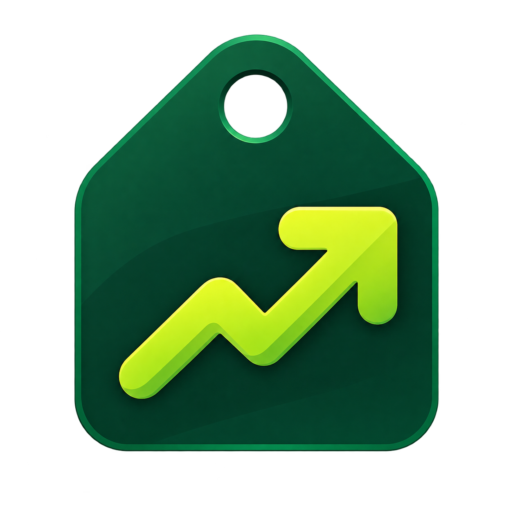

  

<h2 align="center">Buy My SaaS</h2>

A ideia do Buy My SaaS nasceu do [Find-My-Saas](https://find-my-saas.com/) para dar uma vitrine a produtos digitais criados por desenvolvedores autônomos, pequenos times e empresas que estão construindo soluções SaaS.

A plataforma reúne descoberta, publicação, moderação, analytics e pagamentos em uma experiência simples: quem procura ferramentas encontra bons produtos; quem cria SaaS ganha um espaço organizado para apresentar, validar e divulgar sua solução.

## O que é o Buy My SaaS?

Buy My SaaS é um marketplace de SaaS com foco em curadoria e descoberta.

Visitantes podem explorar produtos por categoria, preço, origem, avaliação e popularidade. Makers podem cadastrar seus SaaS, adicionar informações comerciais, enviar logo, revisar o anúncio e acompanhar métricas. Administradores mantêm a qualidade da vitrine aprovando, rejeitando ou removendo publicações quando necessário.

## Para quem é

- Makers lançando um novo SaaS
- Desenvolvedores buscando visibilidade
- Pequenas empresas com produtos digitais
- Usuários procurando ferramentas úteis
- Comunidades que querem descobrir soluções brasileiras e independentes

## Funcionalidades principais

### Descoberta de produtos

- Catálogo público de SaaS publicados
- Página inicial com chamada clara para descoberta e publicação
- Exploração por categorias
- Busca e filtros
- Busca full-text em português com relevância, operadores e tolerância a erros de digitação
- Página individual para cada produto
- Informações de preço, país, tecnologias, categorias e descrição completa
- Links rastreados para site, trial ou checkout do SaaS

### Perfil do produto

Cada SaaS pode ter:

- Nome e tagline
- Descrição curta e completa
- Logo
- Imagens de exemplo do produto
- Categorias
- Tags
- Tecnologias usadas
- Modelo de preço
- Link do site
- Link de trial
- Link de checkout
- Marcação para conteúdo +18
- Avaliações públicas

### Área do maker

O criador do produto pode:

- Entrar com Google
- Cadastrar um SaaS
- Editar informações do produto
- Enviar logo
- Revisar antes de publicar
- Enviar para análise
- Acompanhar favoritos e analytics
- Ver produtos cadastrados no painel

### Moderação administrativa

Administradores podem:

- Ver o painel administrativo
- Acompanhar submissões
- Aprovar produtos
- Rejeitar produtos com motivo
- Remover produtos publicados quando necessário
- Remover avaliações indevidas de produtos publicados
- Moderar avaliações em uma fila dedicada antes da publicação
- Reaprovar edições sensíveis de anúncios já publicados
- Gerenciar permissões de usuários
- Promover usuários comuns para administradores
- Rebaixar administradores quando necessário

### Analytics e engajamento

A plataforma registra interações importantes, como:

- Visualizações de página
- Cliques no site do SaaS
- Cliques em trial
- Cliques em compra
- Favoritos
- Boosts/impulsionamentos únicos por usuário
- Avaliações

Com isso, o maker consegue entender melhor o interesse gerado pelo produto, e a vitrine consegue destacar SaaS em alta por engajamento recente da comunidade — não apenas por data de publicação.

### Pagamentos e publicação

O Buy My SaaS usa a primeira publicação gratuita e após o primeiro produto, cobra um valor simbólico de R$ 9,90. Sendo possível também a monetização por destaque patrocinado.

O maker pode cadastrar e enviar um SaaS para análise sem pagar. Depois que o produto é publicado, ele pode comprar um destaque patrocinado por período fixo. O destaque aparece identificado no catálogo, ganha prioridade na listagem e não substitui a moderação.

## Segurança e qualidade

O projeto foi pensado para evitar depender do frontend como barreira de segurança.

As ações sensíveis são validadas no backend, incluindo:

- Autenticação
- Permissões administrativas
- Ownership de produtos
- Upload seguro de imagens
- Proteção contra URLs perigosas
- Validação de dados enviados pelo usuário
- Auditoria de ações administrativas

Uploads de imagem são validados pelo tipo real do arquivo, não apenas pela extensão ou pelo tipo informado pelo navegador.

Produtos marcados como +18 recebem indicação visual e proteção nas imagens, exigindo confirmação antes da visualização.

## Experiência pública

O visitante consegue navegar pelo marketplace sem precisar criar conta.

Ele pode:

- Explorar produtos
- Abrir detalhes de um SaaS
- Ver avaliações
- Filtrar por categoria
- Acessar o site oficial do produto
- Descobrir ferramentas brasileiras e independentes

## Experiência do maker

O maker tem uma jornada guiada:

1. Cria uma conta
2. Cadastra o SaaS
3. Preenche descrição, preço, categorias e links
4. Envia a logo
5. Revisa o anúncio
6. Envia para análise
7. Acompanha métricas após a publicação
8. Compra ou renova destaque patrocinado para produtos publicados

Esse fluxo ajuda a manter o catálogo organizado e evita publicações incompletas.

## Experiência administrativa

A administração mantém a vitrine limpa e confiável.

O painel permite revisar produtos enviados, aprovar o que está pronto, rejeitar o que precisa de ajustes e controlar quais contas têm permissão administrativa.

## O que já foi construído

- Marketplace público
- Área do maker
- Painel administrativo
- Fluxo de login e cadastro
- Criação e edição de SaaS
- Upload de logo
- Moderação de publicações
- Exclusão administrativa de produtos
- Gestão de permissões de administradores
- Moderação dedicada de avaliações com aprovação, rejeição e auditoria
- Busca full-text ranqueada com índice GIN e fallback por similaridade
- Reaprovação automática após edições sensíveis
- Categorias com contagem apenas de produtos publicados
- Favoritos
- Avaliações
- Analytics
- Integração preparada para Mercado Pago
- Storage local ou S3-compatible
- README público com apresentação do produto

## Tecnologias usadas

O produto foi construído com tecnologias modernas para web, API, banco de dados, testes e deploy.

Entre elas:

- Next.js
- React
- TypeScript
- NestJS
- PostgreSQL
- Prisma
- Docker
- Mercado Pago
- S3-compatible storage
- Playwright
- Jest

## Status do projeto

Buy My SaaS está em fase de MVP funcional.

O produto já cobre a jornada principal: descoberta pública, cadastro de produto, envio para análise, aprovação administrativa e publicação no catálogo.

Próximas evoluções naturais incluem o deploy final com domínio público,
storage externo e Mercado Pago em produção.

## Desenvolvido por

Desenvolvido por [ghenosec](https://github.com/ghenosec).
